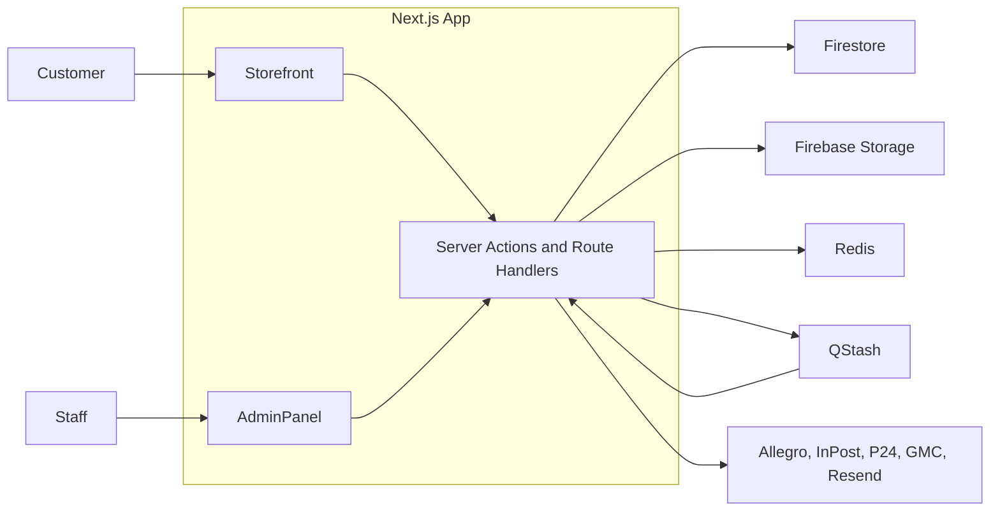

# kama-obuwie.pl

**Production e-commerce platform and internal CRM for a footwear retailer, selling through its own online store, two Allegro accounts and a brick-and-mortar shop.**

Designed and built solo, end to end: product, architecture, backend, frontend, integrations and deployment.

[kama-obuwie.pl](https://kama-obuwie.pl)

`Next.js 15` `React 19` `TypeScript` `Firebase` `Firestore` `Redis` `QStash` `Tailwind CSS` `shadcn/ui` `Zod`

## At a glance

- **700+ products** and **800+ orders per month**, in production since 2025.
- **4 sales channels** with one catalog, one order model and one admin panel.
- **5 external integrations**: Allegro, InPost, Przelewy24, Google Merchant Center and Resend.
- **~51k lines of TypeScript** across 520+ files, with 56 API route handlers, 60 pages and 860+ commits.

## The problem

Before this application, the shop sold mainly through Allegro, and its offers were managed directly in the marketplace. Every new channel meant duplicating products, prices and stock by hand. Orders, shipping labels and returns were handled separately for each account.

The goal was a single source of truth for catalog, pricing, stock and orders. It also had to automate the operational work around them: listing products, fulfilling orders and processing returns.

## What it does

**Storefront**
- Category listings with faceted filters, full-text search, product pages, cart and checkout.
- Delivery by courier or to an InPost parcel locker, with an interactive locker map.
- Payment through Przelewy24 or cash on delivery.
- Transactional emails and GA4 e-commerce events.

**Product onboarding**
- A staged pipeline takes a product from raw data to a live listing: data, photos, photo editing, parameters, description and offer publication.
- Categories and sizing tables are synchronized with Allegro.

**Multi-channel offers**
- One product can be published to several channels, each with its own prices, shipping rates and per-size availability.
- Multi-variant listings on Allegro.
- Products and availability are pushed to Google Merchant Center.

**Order fulfilment**
- Orders from every channel are processed in one workflow, grouped by fulfilment status.
- Shipping labels and courier pickups through InPost and Allegro shipment management.

**Returns and refunds**
- Allegro returns, refunds and return documents.

**Reporting**
- Sales dashboard and customer reports.

## Engineering highlights

### Multi-channel data model
A product (the catalog entity) is separated from an offer, which is its listing in a specific sales channel. Each offer has its own prices, shipping rates, warranties, per-size availability and marketplace IDs. Orders share one schema regardless of source, so storefront and Allegro sales go through the same fulfilment flow.

### Legacy Allegro migration
Offers created on Allegro before the application existed are imported into a separate `legacyProducts` collection. Their IDs are derived deterministically from a hash of the normalized product signature (brand, manufacturer code, color variant). Re-running the import therefore updates existing records instead of creating duplicates.

### Long-running sync without serverless timeouts
A full sync of the Allegro catalog, or of Google Merchant Center availability, does not fit in a single request. Work is published to QStash and processed in batches by signature-verified workers. Each worker queues the next batch, chained across both Allegro accounts. Job state and progress live in Redis and are shown in the admin panel. Allegro orders are pulled on a schedule through the same mechanism.

### Custom search engine
Full-text search is built on MiniSearch with a Polish Snowball stemmer (WASM) and a synonym dictionary. Queries are parsed for structured intent: category, color, material and fastening. Documents matching that intent get a ranking bonus, so "black leather sneakers" is not treated as a bag of words. The index is cached in instance memory and in Redis, and invalidated on product or offer writes.

### Faceted listings
Filters are derived from product attributes, with color and attribute normalization. Filter state lives in the URL, which keeps listings linkable and crawlable.

### Production integrations
- **Allegro**: OAuth with token refresh for two seller accounts, plus offers, orders, returns, refunds, shipping rates and labels.
- **Przelewy24**: transaction registration, status webhook and payment verification.
- **InPost ShipX**: shipment creation, labels and the parcel locker widget.
- **Google Merchant Center**: product and availability management through the Merchant API.
- **Resend**: transactional emails rendered from React Email components.

### Type-safe boundaries
TypeScript runs in strict mode. Zod schemas define the contract for Firestore documents, forms and external API payloads. Firestore is accessed only on the server, through the Admin SDK.

### Admin authentication
Users sign in with Firebase Auth. The server verifies the ID token, creates a session in Redis and issues an `HttpOnly` cookie. Access to the admin panel is enforced server-side, with role-based checks.

## Architecture

A single Next.js App Router application serves the storefront, the admin panel and the integration API. Server Components are the default. Client components are used only where there is interaction: cart, filters, checkout and admin forms.

Mutations go through Server Actions. Route Handlers cover what Server Actions cannot: payment and OAuth webhooks, QStash workers and binary responses such as shipping labels. The application runs on Firebase App Hosting, and all credentials are kept in Secret Manager.

## Tech stack

- **Framework**: Next.js 15 (App Router), React 19, TypeScript
- **Data**: Firestore, Firebase Storage, Upstash Redis
- **Background jobs**: Upstash QStash
- **Auth**: Firebase Auth with server-side sessions
- **UI**: Tailwind CSS 4, shadcn/ui (Radix), React Hook Form, TanStack Table
- **Validation**: Zod
- **Search**: MiniSearch, Snowball stemmer
- **Email**: React Email, Resend
- **Hosting**: Firebase App Hosting

## Impact

- Product listing, multi-channel publishing, order fulfilment, shipping labels, returns and refunds are automated or handled from one panel, instead of across separate marketplace accounts.
- The whole store runs on a single system: catalog, pricing, stock, orders and reporting.
- The storefront gives the business a sales channel independent of the marketplace.
